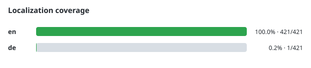

# Contributing to caddy/ui

Thanks for considering a contribution. This project is a two-service app (Node/Express backend, React/Vite frontend) that manages a Caddy server through its admin API — see the [README](README.md) for the full architecture overview.

## Getting set up

You don't need Docker for day-to-day development, but you do need a Caddy instance with its admin API reachable (`CADDY_ADMIN_URL`, default `http://caddy:2019`) for the backend to talk to.

### Backend

```bash
cd backend
npm install
npm run dev   # node --watch src/index.js, listens on :3001 by default
```

Relevant environment variables are documented in the [README's Environment Variables table](README.md#environment-variables). Most have safe local defaults.

### Frontend

```bash
cd frontend
npm install
npm run dev   # vite dev server
```

The `predev`/`prebuild` scripts fetch `src/lib/caddyfileMode.js` (the generated CodeMirror Caddyfile grammar) from [zackwag/caddyfile-codemirror](https://github.com/zackwag/caddyfile-codemirror) — that file is gitignored, not vendored. Run `npm run dev` or `npm run build` at least once with network access before working offline; after that the fetch script falls back to the local copy.

## Tests

Backend and frontend tests use [Vitest](https://vitest.dev/):

```bash
cd backend
npm test

cd ../frontend
npm test
```

The frontend test command also validates the localization catalog contract. CI runs tests plus lint in both `backend/` and `frontend/` on every PR against `main` (`.github/workflows/test.yml`). Frontend UI changes still need a browser check because the tests do not cover full rendering and interaction behavior.

## Verifying UI changes

For anything touching `frontend/`, run the dev server and click through the affected view(s) in a browser before opening a PR — type-checking and the backend test suite don't cover rendering or interaction correctness. Check both the dark and light themes if you touched styling.

## Code style

- Match the existing style in the file you're editing: ES modules, 4-space indentation, single quotes, semicolons.
- Both `backend/` and `frontend/` have an ESLint config (`npm run lint` in each) that CI runs on every PR (`.github/workflows/test.yml`). It only checks for correctness issues (unused vars, React hook rules, etc.) — it doesn't enforce formatting, so consistency with surrounding code is still the bar for style.
- Keep changes scoped — avoid drive-by refactors in unrelated files.


### Localization



User-facing frontend text must come from the locale catalog rather than hard-coded string literals. The frontend ESLint rule `i18next/no-literal-string` covers `frontend/src/**` and CI treats localization warnings as failures.

`frontend/src/i18n/locales/en.js` is the canonical schema and fallback language:

- `en.js` must always exist.
- Other locale files may contain fewer translation leaves than English; missing keys fall back to English.
- Other locale files must not introduce keys or key-tree shapes that are absent from `en.js`.
- Every locale, including English, must define a non-empty `test.languageLoaded` string. The frontend language API integration test uses that probe to verify that advertised installed locales load successfully.
- Run `npm run i18n:check` after changing locale catalogs. `npm run i18n:coverage` regenerates the coverage graph.

**Translations must be human-authored. Machine-generated, agentic, LLM-produced, or bulk machine translations are not accepted.** Opening a PR that adds or changes non-English values under `frontend/src/i18n/locales/` is an explicit attestation that those translations were supplied or reviewed by a human who can vouch for them. By submitting that PR, the contributor accepts this rule.

Agents may maintain the English source catalog and perform purely mechanical schema-preserving changes, but they must not author translated non-English text.

If a literal is intentionally not UI copy (for example a Caddy directive, protocol value, API path, browser/storage key, or other technical token), prefer a narrow, documented technical exception. Do not broaden the exceptions to hide user-facing ASCII text.

```js
// eslint-disable-next-line i18next/no-literal-string -- Caddy directive, not UI copy
const example = 'reverse_proxy';
```

Keep exceptions narrow and descriptive so reviewers can distinguish intentional technical literals from untranslated UI text.

## Commit messages / PR titles

This repo loosely follows [Conventional Commits](https://www.conventionalcommits.org/) prefixes in PR titles (squash-merged), e.g.:

- `feat: ...` — new functionality
- `fix: ...` — bug fixes
- `build: ...` — build/CI/dependency changes
- `test: ...` — test-only changes

Look at `git log` for more examples of the house style.

## Opening a PR

1. Branch off `main`.
2. Keep the diff focused on one change.
3. Make sure `npm test` passes in `backend/` if you touched backend code, and `npm run lint` passes in `backend/`/`frontend/` for whichever side you touched.
4. Don't edit `CHANGELOG.md` or bump versions by hand — [release-please](https://github.com/googleapis/release-please) generates the changelog and version from your PR title's Conventional Commit prefix once it's merged to `main`.
5. Open the PR against `main` — the `Test` workflow will run automatically.

## Reporting issues

Open a GitHub issue with steps to reproduce, your `caddy-ui` version (`GET /api/version` or the sidebar), and relevant logs (`LOG_LEVEL=debug` on the backend gives more detail). Stale issues without activity are auto-closed by `.github/workflows/stale.yml`, so keep threads updated if you're still waiting on something.
