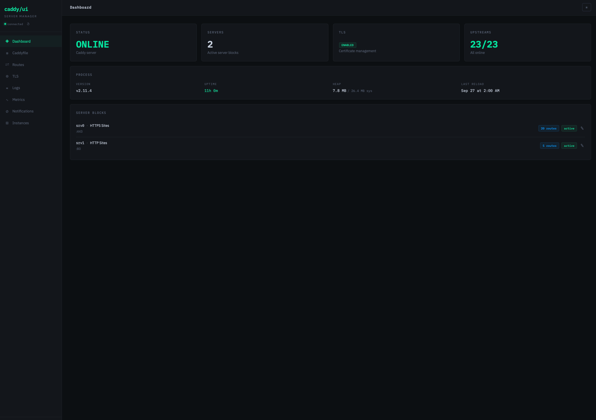

<!--
README.md is the canonical source for Docker Hub descriptions and shared book references.

Docker Hub routing — only blocks marked dockerhub:both, dockerhub:backend or
dockerhub:frontend are selected. Use matching start/end markers on separate lines;
do not nest or overlap them. Include headings inside a block if they should appear in
the generated page. Blocks may repeat and are collected in README order. Keep
start/end markers outside fenced code blocks. Close a block before detailed content
that should stay on GitHub (for example, the Mermaid diagram). Image-specific
introductions and companion-image notices are marked frontend or backend near the
document title. The generator supplies the image title and generated notice; the
introductory prose comes from this README. These markers select content; they do not
generate or publish files themselves.

ANCHOR / ANCHOR_END comments let mdBook include shared sections directly.
Keep environment variables, API reference and the Compose example here. Detailed
explanations and onboarding live in docs/src/. Do not edit generated DOCKERHUB.md files.
-->

# caddy/ui

A modern, self-hosted web interface for managing your [Caddy](https://caddyserver.com) server. Built from scratch in a single conversation with Claude.


<details>
<summary>Docker image roles</summary>

<!-- dockerhub:frontend:start -->
The web frontend for [caddy/ui](https://hub.docker.com/r/zackwag/caddy-ui-backend), a web interface for managing your [Caddy](https://caddyserver.com) server. Built with React and served via Nginx.

> This is the **frontend** image. You will also need the [backend image](https://hub.docker.com/r/zackwag/caddy-ui-backend).
<!-- dockerhub:frontend:end -->

<!-- dockerhub:backend:start -->
The API backend for [caddy/ui](https://hub.docker.com/r/zackwag/caddy-ui-frontend), a web interface for managing your [Caddy](https://caddyserver.com) server. Built with Node.js and Express.

> This is the **backend** image. You will also need the [frontend image](https://hub.docker.com/r/zackwag/caddy-ui-frontend).
<!-- dockerhub:backend:end -->
</details>

<!-- ANCHOR: overview -->
<!-- dockerhub:both:start -->
## Overview

caddy/ui is a self-hosted management interface for Caddy. It runs as two Docker containers alongside your Caddy instance(s) and communicates with Caddy's built-in admin API. Your Caddyfile remains the source of truth — the UI reads from it, writes to it, and never takes ownership away from you. Manage one Caddy server or many from a single interface.

<!-- dockerhub:both:end -->
<!-- ANCHOR_END: overview -->

Use caddy/ui to inspect server health, edit Caddyfiles, manage routes and TLS certificates,
follow logs and metrics, and configure notifications from one place. It supports multiple
instances, optional authentication, and responsive dark/light themes.



**[Read the documentation](https://zackwag.github.io/caddy-ui/)** ·
[Browse the Markdown sources](docs/src/SUMMARY.md) ·
[Contribute](CONTRIBUTING.md)

<details>
<summary>Full feature list</summary>

<!-- ANCHOR: features -->
<!-- dockerhub:both:start -->
## Features
<!-- dockerhub:both:end -->

### Frontend

<!-- dockerhub:frontend:start -->
- **Dashboard** — Live server status, TLS state, an HTTP servers table (label, Server ID, listen address, route count) with optional labels, upstream health overview, and Caddy process info (version, uptime, memory, last reload)
- **Caddyfile Editor** — Edit your Caddyfile with [real Caddyfile-grammar syntax highlighting](https://zackwag.github.io/caddy-ui/caddyfile.html#caddyfile-syntax-highlighting) (directives, matchers, placeholders, env vars — not a generic nginx approximation), live validation, `caddy fmt` formatting, automatic site block sorting, export/import, and full version history with inline preview and one-click rollback
- **Route Manager** — View all reverse proxy routes across all HTTP servers, with a live health-status column (hover for uptime %), search/filter by domain, upstream, note, or server, sortable columns, a column picker to show/hide Title/Upstream/Server/ID, clickable domain and upstream links, edit routes in-place, and per-route notes
- **TLS Certificates** — View cert status, expiry dates, and sortable columns for all managed domains. Detect and delete orphaned certs. Download Caddy's root CA cert with per-OS install instructions
- **Access Logs** — Tail live log output with SSE streaming, real-time keyword search, ERROR/WARN/INFO level filters, and log export
- **Log Configuration** — Enable, disable, and configure Caddy access logging directly from the UI
- **Metrics** — Request count, RPS, avg response time, status code breakdown, and p50/p95/p99 percentiles powered by Caddy's built-in Prometheus endpoint
- **Uptime** — On the Metrics tab, uptime %, current state, and a status history timeline for every route's upstream, recorded every 30s in the background. Optional **route checks** also request each site through Caddy every 5 minutes (User-Agent `caddy-ui-route-check`), so a route counts as down when its upstream accepts connections but the site returns 5xx, times out, or serves a certificate a browser would reject (expired, wrong name, or not issued by a trusted CA — Caddy's own local CA is trusted automatically). An offline route shows why its last check failed, and routes that can't be checked meaningfully can be skipped individually. Route checks are off by default because those requests appear in Caddy's access logs and request metrics.
- **Notifications** — Push alerts via ntfy, Discord, Slack, Pushover, or custom webhook when upstreams go offline/online, routes go down/recover (with route checks on), or TLS certs are expiring. Configurable debounce and per-trigger opt-in
- **26 Themes + Custom Themes** — Choose from 13 dark and 13 light palettes (VT2026, Dracula, Nord, Catppuccin, Tokyo Night, Gruvbox, One Dark Pro, Solarized, Material, GitHub, Ayu, Night Owl, Metro, and more), or drop your own into [`THEMES_PATH`](https://zackwag.github.io/caddy-ui/themes.html#custom-themes) for a fully custom palette. Pick one palette for dark mode and one for light mode, then toggle between them with one click. First-run welcome modal helps new users choose. Preferences stored server-side in `settings.json`
- **URL-Based Navigation** — Full browser history support, bookmarkable URLs, and deep links (e.g. `/routes?filter=srv0`)
- **Authentication** — Optional JWT-based login screen protecting the UI and authenticated API routes
- **Multi-Instance** — Manage multiple Caddy instances from a single UI. Auto-discover Caddy containers on your Docker network, add/edit/remove instances from the Instances page, and switch between them with the sidebar instance switcher
- **Mobile Friendly** — Responsive layout with collapsible sidebar
<!-- dockerhub:frontend:end -->

### Backend

<!-- dockerhub:backend:start -->
- Proxies requests to Caddy's admin API (`/config`, `/id`, `/load`)
- Reads and writes the Caddyfile on disk
- Runs `caddy validate` via Caddy's `/adapt` admin API endpoint
- Runs `caddy fmt` and detects Caddy version via `docker exec` into the running Caddy container (requires Docker socket mount)
- Sorts Caddyfile site blocks on save (public → internal → http)
- Appends, updates, and removes site blocks when routes are managed via the UI
- Fetches routes from all HTTP servers with recursive upstream extraction for complex route structures
- Health checks use Caddy's reverse proxy upstream pool API as primary source, with TCP fallback for upstreams not yet in the pool
- Persisted per-upstream uptime history with a configurable retention window (default 7 days)
- Push notifications via ntfy, Discord, Slack, Pushover, or custom webhook — triggered on upstream offline/online and cert expiry
- Configurable notification debounce to suppress repeat alerts
- Reads TLS certificate files from disk and parses expiry dates
- Detects and deletes orphaned, superseded, and expired certificates (resolves issuer directory automatically)
- Root CA cert download via Caddy's `/pki/ca/local` admin API
- Automatic Caddyfile snapshots on every save with configurable retention
- Tails and streams access logs via SSE
- Parses and updates log configuration in the global Caddyfile block
- Persists server labels and route notes to disk
- Optional JWT authentication for protected API endpoints
- Caddy process info and HTTP metrics via Prometheus endpoint
- Metrics enable/disable toggle that modifies the Caddyfile global block
- Optional public `/api/metrics/raw` endpoint for Prometheus scraping
- Structured JSON logging with configurable log level via `LOG_LEVEL`
- Enriched status endpoint with route count, upstream health, and uptime for Homepage widget support
<!-- dockerhub:backend:end -->
<!-- ANCHOR_END: features -->

</details>

## Get started

You need Docker Compose and a Caddy container with its admin API enabled inside your Docker network.
Follow the [setup guide](https://zackwag.github.io/caddy-ui/setup.html) to configure Caddy,
create the required directories, and deploy both caddy/ui containers. Then open
`http://your-server:9877` and add or discover your instance.

<details>
<summary>Canonical Quick Start and Compose example</summary>

<!-- ANCHOR: quick-start -->
<!-- dockerhub:both:start -->
## Quick Start

### Prerequisites

- Docker and Docker Compose
- An existing Caddy container with the admin API enabled on `0.0.0.0:2019`

### 1. Enable Caddy's admin API

Add the following to your Caddyfile global block:

```caddyfile
{
    admin 0.0.0.0:2019
    email {$EMAIL}
}
```

> Note: the `CADDY_ADMIN` environment variable does not configure this — it must be set in the Caddyfile.

### 2. Create required directories

```bash
mkdir -p /docker/caddy/logs
mkdir -p /docker/caddy-ui
```

### 3. Generate a JWT secret (if using auth)

```bash
openssl rand -base64 32
```

### 4. Update your compose file

```yaml
services:
  caddy:
    image: caddy:latest
    container_name: caddy
    restart: unless-stopped
    ports:
      - 80:80
      - 443:443
    environment:
      - CADDY_LOG_PATH=/var/log/caddy/access.log
      - DOMAIN=example.com
      - EMAIL=you@example.com
      - TZ=America/New_York
    volumes:
      - /docker/caddy/Caddyfile:/etc/caddy/Caddyfile
      - /docker/caddy/data:/data
      - /docker/caddy/config:/config
      - /docker/caddy/logs:/var/log/caddy
    networks:
      - caddy-ui

  caddy-ui-backend:
    image: zackwag/caddy-ui-backend:latest
    container_name: caddy-ui-backend
    restart: unless-stopped
    ports:
      - 9876:3001
    environment:
      - TZ=America/New_York
      # Optional -- leave unset to disable auth
      - CADDY_UI_USER=admin
      - CADDY_UI_PASSWORD=yourpassword
      - JWT_SECRET=your-long-random-secret
    volumes:
      - /var/run/docker.sock:/var/run/docker.sock
      - /docker/caddy-ui:/etc/caddy-ui
    networks:
      - caddy-ui
    depends_on:
      - caddy

  caddy-ui-frontend:
    image: zackwag/caddy-ui-frontend:latest
    container_name: caddy-ui-frontend
    restart: unless-stopped
    ports:
      - 9877:80
    networks:
      - caddy-ui
    depends_on:
      - caddy-ui-backend

networks:
  caddy-ui:
    driver: bridge
```

The backend only needs two volumes: the **Docker socket** (to interact with Caddy containers via `docker exec` and discover new instances) and its own **config directory** (for instance registry, history, and settings). No Caddy volume mounts required — all Caddyfile, log, and certificate operations go through the Docker socket.

### 5. Deploy

```bash
docker compose up -d
```

Open `http://your-server:9877` in your browser.

<!-- dockerhub:both:end -->
<!-- ANCHOR_END: quick-start -->

</details>

<!-- ANCHOR: architecture -->
<!-- dockerhub:both:start -->
## Architecture
caddy/ui runs as two services: a React frontend served by Nginx and a Node.js/Express backend. The frontend proxies API requests to the backend, which communicates with Caddy's admin API.

In Docker mode, the backend uses the Docker socket for container discovery and file operations inside Caddy containers. Its persistent configuration directory stores application settings and instance data. Local mode supports Caddy installations outside Docker. The Caddyfile remains the source of truth.

<!-- dockerhub:both:end -->
<!-- ANCHOR_END: architecture -->

See the [architecture guide](https://zackwag.github.io/caddy-ui/architecture.html)
for the service connections, and [instances](https://zackwag.github.io/caddy-ui/instances.html)
for Docker and local-mode deployments.

## Configuration and integrations

The [configuration reference](https://zackwag.github.io/caddy-ui/configuration.html),
[API reference](https://zackwag.github.io/caddy-ui/api.html), and
[integration guides](https://zackwag.github.io/caddy-ui/integrations.html) organize the
shared reference below, with additional guidance for [themes](https://zackwag.github.io/caddy-ui/themes.html)
and [Caddyfile behavior](https://zackwag.github.io/caddy-ui/caddyfile.html).

<details>
<summary>Canonical environment variables, API and integration examples</summary>

<!-- ANCHOR: environment-variables -->
<!-- dockerhub:backend:start -->
## Environment Variables

All backend variables have sensible defaults. Only set what you need to override.

| Variable | Default | Description |
|----------|---------|-------------|
| `APP_VERSION` | `dev` | caddy-ui's own version, exposed at `GET /api/version` and shown in the sidebar. Baked in automatically by the release build (`docker build --build-arg APP_VERSION=...`) — no need to set by hand unless building from source and want the UI to report a specific version. |
| `CADDY_ADMIN_URL` | — | URL of Caddy's admin API. If set, a default instance is auto-created on first startup. If unset, caddy/ui starts with no instances and guides you through discovery. |
| `CADDYFILE_TITLES` | auto | Store route titles as `#` comments in the Caddyfile (see [Caddyfile Titles](https://zackwag.github.io/caddy-ui/caddyfile.html#caddyfile-titles)) |
| `CADDY_CONFIG_PATH` | `/etc/caddy/Caddyfile` | Path to the Caddyfile inside the Caddy container (only used with `CADDY_ADMIN_URL`) |
| `CADDY_CONTAINER_NAME` | `caddy` | Name of the Caddy Docker container (only used with `CADDY_ADMIN_URL`) |
| `CADDY_DATA_PATH` | `/data/caddy` | Path to Caddy's data directory inside the container (only used with `CADDY_ADMIN_URL`) |
| `CADDY_LOG_PATH` | `/var/log/caddy/access.log` | Path to Caddy's access log inside the container (only used with `CADDY_ADMIN_URL`) |
| `CADDY_SERVER_NAME` | `srv0` | Server ID of the Caddy HTTP server new routes are added to, usually `srv0` (only used with `CADDY_ADMIN_URL`). Server IDs come from Caddy; set your own with the `name` option of the Caddyfile's global `servers` block |
| `CADDY_UI_PASSWORD` | — | Password for UI authentication |
| `CADDY_UI_PUBLIC_METRICS` | `false` | Expose `/api/metrics/raw` without auth |
| `CADDY_UI_UPDATE_CHECK` | `true` | Check hourly for newer caddy-ui images and show an "Update available" badge in the sidebar (plus a notification for new releases, if notifications are on). Reads a small `versions.json` from GitHub (`raw.githubusercontent.com`); set to `false` to disable |
| `CADDY_UI_UPDATE_CHECK_URL` | `https://raw.githubusercontent.com/zackwag/caddy-ui/versions/versions.json` | Where the update check reads published image versions from |
| `CADDY_UI_USER` | — | Username for UI authentication (leave unset to disable) |
| `DOCKER_SOCKET` | `/var/run/docker.sock` | Path to the Docker socket for container discovery and `docker exec` operations |
| `HISTORY_PATH` | `/etc/caddy-ui/history` | Path to the Caddyfile snapshot directory |
| `INSTANCES_PATH` | `/etc/caddy-ui/instances.json` | Path to the multi-instance configuration file (see [Multi-Instance](https://zackwag.github.io/caddy-ui/instances.html#multi-instance)) |
| `JWT_SECRET` | — | Secret key for signing JWT tokens |
| `LOG_LEVEL` | `info` | Log verbosity (`debug`, `info`, `warn`, `error`) |
| `MAINTENANCE_PATH` | `/etc/caddy-ui/maintenance.json` | Path to the maintenance mode state file |
| `NOTIFICATIONS_CONFIG_PATH` | `/etc/caddy-ui/notifications.json` | Path to the notification settings file |
| `PORT` | `3001` | Port the backend listens on |
| `ROUTE_NOTES_PATH` | `/etc/caddy-ui/route-notes.json` | Path to the route notes file |
| `SERVER_NAMES_PATH` | `/etc/caddy-ui/server-names.json` | Path to the per-instance server labels file |
| `SETTINGS_PATH` | `/etc/caddy-ui/settings.json` | Path to the UI settings file (theme preferences, column visibility) |
| `THEMES_PATH` | `/etc/caddy-ui/themes` | Path to the custom themes directory (see [Custom Themes](https://zackwag.github.io/caddy-ui/themes.html#custom-themes)) |
| `UPTIME_HISTORY_PATH` | `/etc/caddy-ui/uptime-history.json` | Path to the persisted upstream and route uptime history file |
| `UPTIME_HISTORY_RETENTION_DAYS` | `7` | How many days of upstream and route health checks to retain |
| `WWW_PATH` | `/etc/caddy-ui/www` | Directory for the maintenance page HTML file (created on first use) |
| `NODE_EXTRA_CA_CERTS` | — | Path to a PEM bundle of extra CAs for route checks to trust, for sites with certificates from a private CA other than Caddy's local one (standard Node.js variable) |

<!-- dockerhub:backend:end -->
<!-- ANCHOR_END: environment-variables -->


<!-- ANCHOR: authentication -->
<!-- dockerhub:backend:start -->
## Authentication

Authentication is disabled by default. Set `CADDY_UI_USER`, `CADDY_UI_PASSWORD`, and `JWT_SECRET` to enable it. When enabled, protected API endpoints require a valid JWT and the login screen appears automatically.

`GET /api/auth/status` and `GET /api/version` remain public. `POST /api/auth/sessions` validates the configured credentials to issue a JWT; it does not require an existing token. With `CADDY_UI_PUBLIC_METRICS=true`, `GET /api/metrics` and `GET /api/metrics/raw` are also accessible without a JWT.
<!-- dockerhub:backend:end -->
<!-- ANCHOR_END: authentication -->


<!-- ANCHOR: prometheus-metrics -->
<!-- dockerhub:backend:start -->
## Prometheus Metrics

Enable Caddy's metrics endpoint from the Metrics tab, or add `metrics` to your Caddyfile global block manually. Set `CADDY_UI_PUBLIC_METRICS=true` to expose `/api/metrics/raw` without auth for Prometheus scraping.

```yaml
scrape_configs:
  - job_name: caddy
    static_configs:
      - targets: ['caddy-ui-backend:3001']
    metrics_path: /api/metrics/raw
```

Alongside Caddy's own metrics, the endpoint serves caddy-ui's upstream uptime history for **every** instance (labeled `instance_id`, `instance_name`, `upstream`), plus route check history when route checks are on (labeled `instance_id`, `instance_name`, `route`), even when Caddy's metrics are disabled:

| Metric | Description |
|---|---|
| `caddy_ui_upstream_up` | Result of the most recent check (1 = online, 0 = offline) |
| `caddy_ui_upstream_uptime_ratio` | Fraction of retained checks that were online (see `UPTIME_HISTORY_RETENTION_DAYS`) |
| `caddy_ui_upstream_state_duration_seconds` | Time the upstream has been in its current state |
| `caddy_ui_route_up` | Result of the most recent route check (1 = online, 0 = offline) |
| `caddy_ui_route_uptime_ratio` | Fraction of retained route checks that were online |
| `caddy_ui_route_state_duration_seconds` | Time the route has been in its current state |
| `caddy_ui_caddy_metrics_up` | Whether Caddy's `/metrics` could be scraped for the requested instance |

Upstreams that haven't been checked in 5 minutes, and routes that haven't been checked in 12.5 minutes (2.5 route check intervals), are omitted: they've been removed from the config, skipped, or their instance is unreachable.
<!-- dockerhub:backend:end -->
<!-- ANCHOR_END: prometheus-metrics -->


<!-- ANCHOR: homepage-widget -->
<!-- dockerhub:backend:start -->
## Homepage Widget

The status endpoint returns enriched data for use with [Homepage](https://gethomepage.dev):

```yaml
- Caddy:
    href: https://caddy.home
    icon: caddy.png
    widget:
        type: customapi
        url: http://caddy-ui-backend:3001/api/status
        mappings:
            - field: online
              label: Status
              format: text
              remap:
                  - value: true
                    to: Online
                  - value: false
                    to: Offline
            - field: routeCount
              label: Routes
              format: number
            - field: upstreamsOnline
              label: Upstreams
              format: number
            - field: uptime
              label: Uptime
              format: text
```
<!-- dockerhub:backend:end -->
<!-- ANCHOR_END: homepage-widget -->


<!-- ANCHOR: api-endpoints -->
<!-- dockerhub:backend:start -->
## API Endpoints

| Method | Endpoint | Description |
|--------|----------|-------------|
| `POST` | `/api/auth/sessions` | Authenticate and receive a JWT token |
| `GET` | `/api/auth/status` | Check if auth is enabled |
| `GET` | `/api/metrics` | Parsed HTTP metrics for the Metrics tab |
| `GET` | `/api/metrics/config` | Check if Caddy metrics directive is enabled |
| `PUT` | `/api/metrics/config` | Enable or disable Caddy metrics directive |
| `GET` | `/api/metrics/raw` | Raw Prometheus metrics (public if `CADDY_UI_PUBLIC_METRICS=true`) |
| `GET` | `/api/status` | Server status, route count, upstream health, and uptime |
| `GET` | `/api/status/caddy-config` | Full raw Caddy JSON config |
| `GET` | `/api/status/process` | Caddy process info including version |
| `GET` | `/api/caddyfile` | Read Caddyfile from disk |
| `GET` | `/api/caddyfile?download=true` | Download Caddyfile as a timestamped attachment |
| `PUT` | `/api/caddyfile` | Save, validate, format, and reload |
| `POST` | `/api/caddyfile/validations` | Validate (and optionally format) without saving |
| `POST` | `/api/caddyfile/reloads` | Reload Caddy from disk |
| `GET` | `/api/caddyfile/history` | List all Caddyfile snapshots |
| `GET` | `/api/caddyfile/history/:filename` | Read a specific snapshot |
| `DELETE` | `/api/caddyfile/history/:filename` | Delete a snapshot |
| `GET` | `/api/routes` | List all routes across all HTTP servers |
| `POST` | `/api/routes` | Add a reverse proxy route |
| `PATCH` | `/api/routes/:id` | Update a UI-managed route by ID |
| `DELETE` | `/api/routes/:id` | Remove a route and its Caddyfile block |
| `GET` | `/api/route-notes` | Read all route notes |
| `PUT` | `/api/route-notes/:domain` | Set or clear a route note |
| `GET` | `/api/health` | Check upstream health via Caddy pool API with TCP fallback |
| `GET` | `/api/health/uptime` | Uptime stats per upstream from persisted history |
| `GET` | `/api/health/history` | Raw timestamped checks for one upstream, for the route status history view |
| `GET` | `/api/tls` | List all certificates with expiry and status |
| `DELETE` | `/api/tls/:domain` | Delete an orphaned, superseded, or expired internal cert |
| `GET` | `/api/tls/ca` | Download Caddy's root CA certificate |
| `GET` | `/api/logs` | Last 200 lines of the access log |
| `GET` | `/api/logs/stream` | SSE stream of live log output |
| `GET` | `/api/logs/config` | Read log configuration |
| `PUT` | `/api/logs/config` | Update log configuration |
| `GET` | `/api/server-names` | Read server labels for the selected instance |
| `GET` | `/api/server-names/all` | Read server labels for every instance |
| `PUT` | `/api/server-names/:id` | Set a server label |
| `DELETE` | `/api/server-names/:id` | Remove a server label |
| `GET` | `/api/notifications/config` | Read notification settings |
| `PUT` | `/api/notifications/config` | Update notification settings |
| `POST` | `/api/notifications/test` | Send a test notification |
<!-- dockerhub:backend:end -->
<!-- ANCHOR_END: api-endpoints -->


<!-- ANCHOR: custom-nginx -->
<!-- dockerhub:frontend:start -->
## Custom Nginx Config

The frontend proxies API requests to `caddy-ui-backend:3001` by default. This configuration also applies to prebuilt images. If your backend has a different hostname or port, mount a custom Nginx config:

```yaml
volumes:
  - ./nginx.conf:/etc/nginx/conf.d/default.conf
```

<!-- dockerhub:frontend:end -->
<!-- ANCHOR_END: custom-nginx -->

</details>

## Docker images

| Service | Image |
|---------|-------|
| Frontend | [zackwag/caddy-ui-frontend](https://hub.docker.com/r/zackwag/caddy-ui-frontend) |
| Backend | [zackwag/caddy-ui-backend](https://hub.docker.com/r/zackwag/caddy-ui-backend) |

Both images are required. The frontend serves the UI and proxies requests to the backend.

<!-- ANCHOR: image-tags -->
<!-- dockerhub:both:start -->
## Image Tags

| Tag | Description |
|-----|-------------|
| `latest` | Most recent stable release |
| `beta` | Pre-release build of a specific branch or pull request, published manually for testing |
| `edge` | Most recent build of any kind: every push to `main` and every `beta` build. May contain unreleased or unmerged changes |

See [GitHub releases](https://github.com/zackwag/caddy-ui/releases)
for versioned image tags and release notes.

<!-- dockerhub:both:end -->
<!-- ANCHOR_END: image-tags -->

## Contributing

You can contribute code, improve the documentation, or help with localization once its
foundation is merged. Start with [CONTRIBUTING.md](CONTRIBUTING.md) to choose a path.

## Releases and license

See [GitHub releases](https://github.com/zackwag/caddy-ui/releases), [CHANGELOG.md](CHANGELOG.md),
and the [earlier release history](https://zackwag.github.io/caddy-ui/releases.html#changelog).

MIT — see [LICENSE](LICENSE).
