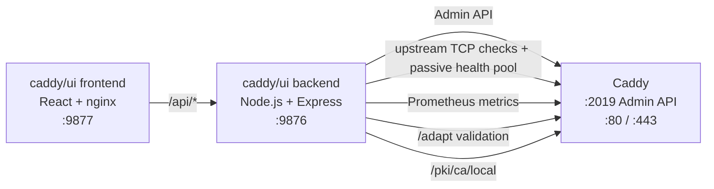
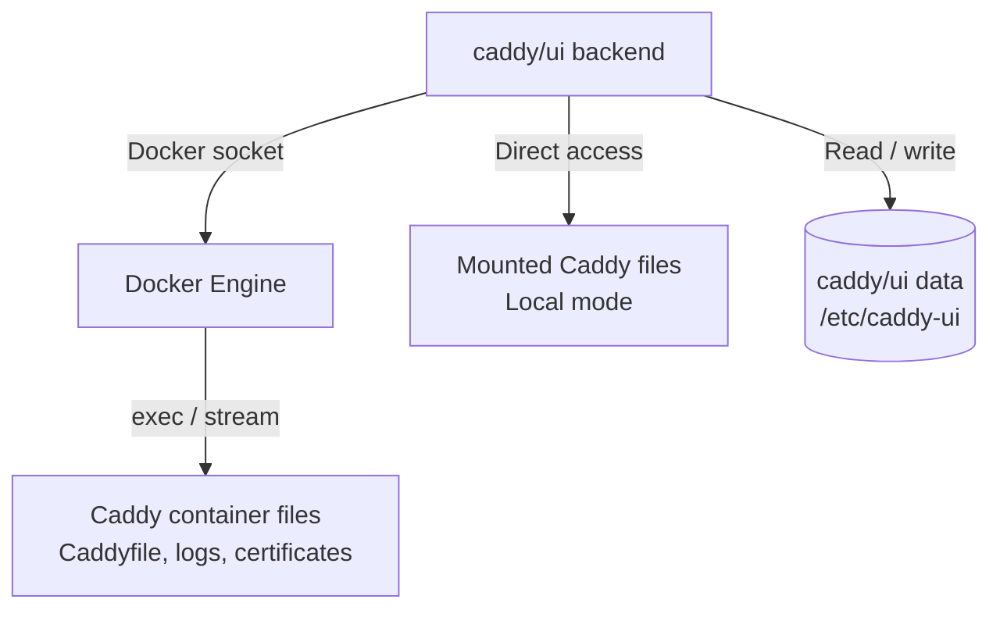

# Architecture

{{#include ../../README.md:architecture}}

## Request flow

The frontend serves the interface and proxies API requests. The backend handles
Caddy operations, application settings, and instance data.

## Files and persistent data

Docker mode uses container discovery and commands inside the selected Caddy
container. Local mode reads and writes paths mounted into the backend and uses
its bundled Caddy binary. Both modes communicate with the instance's admin API.
See the [instance guide](instances.md) for setup and file permissions.

## Responsibilities

| Connection or storage | Purpose |
| --- | --- |
| Frontend → backend | Forward `/api/*` requests from the browser. |
| Backend → Caddy admin API | Read configuration, validate through `/adapt`, reload through `/load`, inspect the upstream health pool, and download the root CA through `/pki/ca/local`. |
| Backend → metrics and upstreams | Read Prometheus metrics; run TCP health checks and optional HTTP route checks. |
| Backend → Docker Engine | Discover Caddy containers and access their Caddyfiles, logs, and certificates through the Docker socket. |
| Backend → mounted Caddy files | Access files directly in local mode. |
| Backend → `/etc/caddy-ui` | Persist instance registrations, configuration history, route notes, settings, and application configuration. |

See the [API reference](api.md), [configuration](configuration.md), and
[integrations](integrations.md) for individual endpoints and settings.

