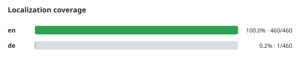

# Contributing to localization



You can start with a handful of related strings in a language you know. A locale
does not have to be complete: missing translations fall back to English, so a
small, reviewed contribution is useful.

## Find the strings

1. Fork and clone the project, or update your existing checkout after the
   localization foundation has merged. Create a branch for your contribution.
2. Open `frontend/src/i18n/locales/en.js`. English defines the key structure and
   the fallback text; use it as your reference.
3. Open the target language's file in the same directory. Choose a small group of
   strings belonging to one screen or interaction, and read their English context.
4. Add or improve those values while preserving the existing keys and nesting.

For a new language, use a lowercase two- or three-letter language-code filename,
such as `de.js`. Export the same object shape as the existing catalogs, including
a non-empty `test.languageLoaded` value supplied in your language. Include only
the keys you intend to translate; copying every English value is unnecessary.

## Translation rules

Translations must be human-supplied or reviewed by a human who can vouch for them.
Machine-generated, LLM/agentic, translation-API, or bulk machine translations are
not accepted. Do not ask a coding agent to author non-English values. By opening
a translation PR, you attest that the submitted values meet the project's human
translation policy.

- English remains the canonical schema and fallback language.
- Do not add keys or change key-tree shapes that are absent from `en.js`.
- Every locale must contain the non-empty `test.languageLoaded` probe.
- Preserve interpolation names such as `{{domain}}`, their spelling, and their
  braces; translate the surrounding text.
- Preserve intentional technical values such as API paths, Caddy directives,
  environment-variable names, and protocol identifiers.
- Check wording in context, especially button labels, confirmation dialogs, and
  messages containing a name or count.

## Validate and preview

From `frontend/`:

```sh
npm ci
npm run i18n:check
npm test
npm run lint -- --max-warnings=0
```

The catalog check catches unknown keys, incompatible structure, and a missing
language probe. It permits incomplete translations. Tests and lint provide the
additional checks used by the localization implementation.

For a full UI preview, follow [codebase setup](contributing-codebase.md#getting-set-up).
Set `CADDY_UI_ADDITIONAL_LANGUAGES` in the backend environment to include your
language code, restart the backend, and select the language in the UI. A matching
locale file must exist for that language to be available.

### Visual translation playground

The playground is a lightweight contributor tool. From `frontend/`:

```sh
npm run i18n:preview
```

Open `http://localhost:5174`. Choose an installed locale, search for an English
key or saved value, choose a component state, and try your translation in its real
component preview. Some keys may not have a registered preview yet. Highlights
identify matching text, tooltips, or input labels; the context inspector provides
DOM selectors and interpolation values. Ambiguous wording is marked explicitly.

The playground keeps drafts only for the current session. Copy your value and
paste it into the target locale file yourself; it does not save edits to the
catalog. Reloading discards drafts. Preserve placeholders and review any warnings.
The playground replays captured real-backend responses without a running backend
or Docker. **Copy preview link** shares a key, language, and state without including
draft text. For capture refresh, optional browser checks, and adding component
states, see the [playground developer guide](https://github.com/zackwag/caddy-ui/blob/main/frontend/playground/README.md).

## Submit a focused PR

Keep the PR to one language and a manageable group of related strings. State the
language, the screens or key groups you covered, whether a fluent reviewer checked
the wording, and which validation/preview commands you ran. If a string needs
more context, explain that in the PR rather than guessing.

The coverage graph is generated from the catalogs. If you need to inspect it,
run `npm run i18n:coverage`; follow the localization workflow's instructions for
generated-file changes and do not edit the graph manually.
