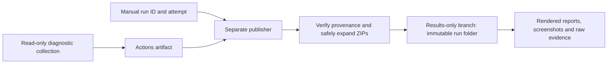
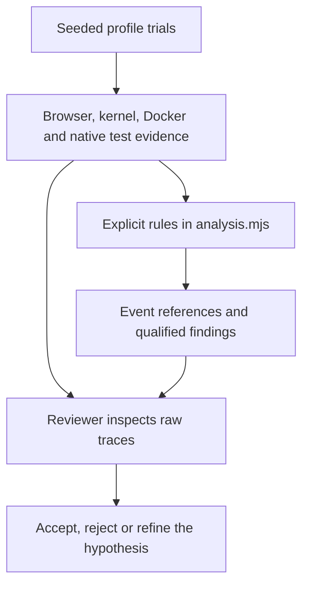

# E2E diagnostic experiments

This manual experiment repeats the checked-out revision's application E2E scenarios with opt-in instrumentation. The collector does not apply fixes or change required PR checks. Candidate branches can change the fixtures/scenarios being measured, so compare source commits and hashes before interpreting results as a before/after comparison. The original pre-fix evidence remains pinned to its source revision.

See [the E2E fix candidates](FIXES.md) for the independent fixes and their local validation. The dispatcher on this branch supports both `dev/etoe-diagnostics` (baseline) and `fix/e-to-e` (candidate). The historical baseline branch is unchanged.

## Run on a fork

The existing **Test** workflow on the default branch is the dispatch entry point. Open **Actions → Test → Run workflow**, select **fix/e-to-e** for the candidate (or **dev/etoe-diagnostics** for the baseline), and run it with operation **collect**. Manual dispatch on either allowed branch calls the diagnostic collector; the ordinary test jobs are skipped for this event only. PR checks and dispatches on other branches retain their usual behavior. Repeated experiments have independent concurrency groups and do not cancel each other.

The default experiment uses three trials per profile, seed `12345`, and the complete suite for the normal profile. GitHub may show the default branch's older input form; use the CLI to set the new inputs explicitly:

```bash
gh workflow run test.yml --repo YOUR_FORK/caddy-ui \
  --ref fix/e-to-e \
  -f diagnostic_operation=collect \
  -f diagnostic_trials=5 \
  -f diagnostic_seed=12345 \
  -f diagnostic_profiles=all \
  -f diagnostic_scope=suite
```

Choose `recovery` instead of `suite` for a smaller experiment focused on the state-notification scenario. Trial counts are limited to 1–20 per profile per dispatch. Start small, then accumulate several independent workflow runs for statistical comparisons.

Use `--ref dev/etoe-diagnostics` instead for a baseline collection. Preserve the exact source commit and runtime versions from each artifact before combining results.

Diagnostic dispatches use per-run concurrency groups, so starting another experiment does not cancel the previous one.

The diagnostic job is reusable through `etoe-diagnostics.yml`; it does not need to be registered separately on the default branch. The existing registered dispatcher makes branch-only execution possible.

## Publish an existing run for browser / phone review

After a diagnostic run completes, publish its artifact through a **separate manual dispatch**. This runs no application tests, creates no containers, and does not affect experiment timing. Both successful and failed collections may be published when their artifact contains a valid `experiment.json`; original outcomes and incomplete-collection metadata remain visible.

```bash
gh workflow run test.yml --repo YOUR_FORK/caddy-ui \
  --ref fix/e-to-e \
  -f diagnostic_operation=publish \
  -f diagnostic_run=RUN_ID \
  -f diagnostic_attempt=1
```

Use the numeric run ID from the **collection** URL (`/actions/runs/RUN_ID`), not the publisher's run. If you reran that collection, select its source attempt explicitly. The Actions form can also expose these inputs once the dispatcher version is registered on the default branch; the CLI works with this branch's inputs now.

The dispatcher calls `publish-etoe-diagnostics.yml`. Only that publication job receives `actions: read` and `contents: write`; the collector retains read-only repository access. The publisher on `fix/e-to-e` accepts only completed, manually dispatched **Test** runs from this repository's exact `dev/etoe-diagnostics` or `fix/e-to-e` branch. It selects the exact `etoe-diagnostics-RUN_ID-ATTEMPT` artifact, checks the download digest when GitHub provides one, and matches the experiment's run/attempt/commit to its source run. Select `fix/e-to-e` for publication of either baseline or candidate runs; the unchanged publisher on the historical baseline branch only accepts baseline runs.

The first publication creates the independent, results-only branch **`dev/etoe-diagnostic-results`**. It does not need merging into `main`. Results accumulate under:

```text
README.md                         # Rendered index of all published runs
runs/RUN_ID/attempt-ATTEMPT/
    README.md                     # Source run, commit, outcome and report link
    provenance.json               # Artifact identity and archive hash
    archive-expansion.json        # Expanded/retained nested ZIPs and limit reasons
    files.sha256.json             # Original/extracted file hashes before adding pages
    artifact/
        README.md                 # Rendered summary and evidence links
        SUMMARY.md                # Unchanged original report
        ...                       # All original artifact folders and files
        001-normal/SCENARIO/
            README.md             # Evidence, screenshot and bounded log previews
            trace.zip             # Original, usable in Playwright
            trace.zip.contents/   # Expanded nested archive, with directory pages
```

Open `https://github.com/YOUR_FORK/caddy-ui/tree/dev/etoe-diagnostic-results`. The publisher's step summary also links the exact run folder at its **publication commit**, so sharing that link pins the output even as more runs are added. GitHub renders the directory READMEs and screenshots on mobile; an interactive Playwright trace still requires its viewer.

Re-publishing the same artifact is a no-op. A run/attempt folder with different provenance is never overwritten. Publication uses ordinary fast-forward pushes and a separate concurrency group; an outside conflicting update fails safely. GitHub may replace an older pending dispatch when multiple publishers are queued, so check that each requested publisher ran before discarding its Actions artifact.

Archives are treated as data and never executed. Every original file and nested ZIP is retained
unchanged. ZIPs are recursively expanded into adjacent `*.zip.contents` directories when
the complete expansion fits the remaining budget. Limits remain 90 MiB per file, 1 GiB of
original/extracted evidence, 20,000 extracted archive entries and three nested ZIP levels.
The initial artifact must fit: required originals that exceed these limits still fail with
the specific file, size or entry allowance in the error. A nested expansion that would
exceed the file, byte or entry budget is skipped as a whole, keeping its ZIP available for
download/Playwright. Smaller later archives may still expand. A directory notice and
`archive-expansion.json` explain each retained ZIP; the run README reports expanded/retained
counts. The original ZIP's SHA-256 remains in `files.sha256.json`, so optional expansion
does not discard source evidence or change collection outcomes.

Extraction still rejects traversal, Git metadata paths, symlinks, duplicate file entries,
output collisions and excessive nesting. Names/types/duplicates are validated even before
an over-budget nested expansion is skipped. Generated pages and manifests have a separate
64 MiB allowance. Directory READMEs are capped at 256 KiB; long reports use bounded inline
excerpts with links to unchanged originals, and oversized previews fall back to GitHub's
file list. Evidence, generated-output sizes and retained ZIP counts are logged separately.
An over-limit initial artifact still requires a smaller collection or direct artifact
download; the Actions artifact is never modified. This tool uses Python 3.11+ standard-library
ZIP support (preinstalled on the Ubuntu runner), without adding application dependencies.

After updating publisher code, start a **new** `publish` dispatch with the same source run ID and attempt. GitHub's **Re-run jobs** uses the old dispatch commit and therefore the old publisher. Neither action requires repeating the original diagnostic collection.



## Profiles

| Profile | What runs | Purpose |
|---|---|---|
| `normal` | The original eight E2E scenarios, or just recovery when requested | Observe ordinary cold-start reliability |
| `slow-style` | Original recovery scenario plus an eight-second local stylesheet delay | Reproduce a toast that disappears before full page load |
| `settled-network` | Original recovery scenario after the owned host veth's IPv6 link-local address becomes ready | Test the delayed-interface hypothesis without changing network settings |
| `localhost` | A fresh browser loading 40 modules from a small local HTTP server; no Caddy container is created | Control for Chromium startup without container creation |

Each trial owns fresh state, browser processes and Vite cache. Profiles run sequentially on the same runner, in seeded randomized order within each repetition. The settled-network control requires Docker and Chromium on the same Linux host; unsupported controls are reported as unavailable and excluded from failure-rate denominators.

Controlled profiles are not estimates of ordinary failure frequency. Their results are reported separately.

## Review the reasoning

Download the `etoe-diagnostics-<run>-<attempt>` artifact. Begin with `SUMMARY.md` and `experiment.json`. `EVIDENCE.md` links each scenario by name to its report. Inspect a trial's `trial.json`, `test.log` and `results.ndjson`. Each scenario directory contains:

- `evidence.md`: observations, interpretation and references to raw evidence.
- `analysis.json`: the rule result with raw event indexes.
- `timeline.json`: requests, failures, document lifecycle, component readiness and toast-node lifetimes.
- `system.json`: timestamped kernel interface events and Docker events filtered to the trial's namespace.
- `browser-netlog.json`: Chromium's default-capture NetLog, including IP-change notifications and error `-21`.
- `trace.zip`, `final.png`, `final.html`, and `backend-log.json` where available.
- `metadata.json` and immutable `ownership.json`: versions, capture limitations and scoped resource identity.



The network rule correlates an IPv6 event on the owned veth with a Chromium IP-change event within 500 ms and interrupted requests / NetLog error `-21`. Clock conversion and stream delivery have finite precision. The rule reports temporal correlation, not proof that every failed assertion came from that event.

The toast rule requires addition and removal of the same toast in the same document, a lifetime of at least 5.9 seconds, and removal before the document's `load` event. This is consistent with the observation race; DOM presence alone does not prove painted visibility.

Both rules have negative-case regression tests. Unclassified failures remain visible. Missing or truncated evidence is reported explicitly. Instrumentation can affect timing, so compare identically instrumented runs rather than treating these rates as production probabilities.

Open a Playwright trace locally with:

```bash
npm exec --prefix frontend -- playwright show-trace /path/to/trace.zip
```

## Results and statistics

A green **collection** job means the experiment collected outcomes and verified scoped cleanup. Individual E2E trials can fail, including controlled reproduction failures. Their exit codes and native test results are retained. Collection errors, cancellation or incomplete native results fail the collector and retain partial artifacts.

Reports include per-profile and per-scenario outcomes, descriptive 95% Wilson intervals, network interruptions, passing trials that encountered interruptions, existing bootstrap retry counts, toast signatures and capture notes. Interrupted trials and unavailable controls are excluded from rate denominators. Failures with incomplete diagnostic evidence still retain their execution outcome and are not silently converted into passes.

Trials in one job share a host. Preserve run/attempt/runner identity and use several workflow jobs when estimating reliability. Do not count the eight scenarios in one suite as eight independent suite trials. Zero observed failures does not establish a zero failure probability.

`experiment.json` records the checked-out commit, dirty-worktree status, relevant source hashes, lockfile hashes, Node/Docker versions and Caddy image digests. Scenario metadata records the actual Chromium version. The CLI retains installed dependency versions through the project's committed lockfiles.

## Local use and cleanup

Prerequisites: Node 22 or later, the pinned backend/frontend dependencies, Docker access, Chromium installed through Playwright, and Linux `ip` for system evidence / the address-settled control.

```bash
npm ci --prefix backend
npm ci --prefix frontend
npm exec --prefix frontend -- playwright install --with-deps chromium
npm run diagnostics:etoe -- --trials 1 --scope recovery --output .etoe-diagnostics/run-1
```

Every experiment requires a new output directory. `PLAYWRIGHT_CHROMIUM_EXECUTABLE_PATH` can select an already installed browser; its actual version is recorded.

The existing fixture owns normal cleanup. The collector additionally verifies and removes only namespaces derived from that trial's fresh nonce and ownership manifests. Fixture leases require matching names, labels, image and an unmounted `none` network before removal. No global prune or network modification is performed. Cleanup failure stops collection rather than continuing with unverified resources.

SIGINT/SIGTERM terminates the trial process group and attempts scoped cleanup before writing a partial summary. A hard runner termination can interrupt cleanup; hosted GitHub runners are disposable. Local outputs retain ownership manifests for inspection.

Regression checks:

```bash
npm run test:etoe-diagnostics
npm run test:etoe-diagnostics:publication # no Docker; archive safety and local Git publication
npm run lint:etoe-diagnostics
npm run test:etoe-diagnostics:integration # real cancellation and sentinel isolation
```
