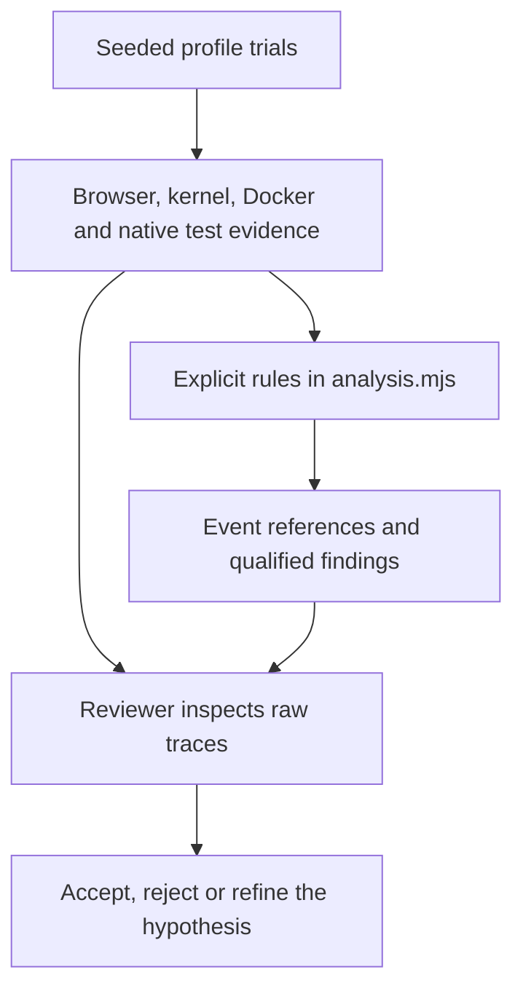

# Pre-fix E2E diagnostics

This manual experiment repeats the existing application E2E scenarios with opt-in instrumentation. It preserves their actions, assertions, timers and existing bootstrap retry. It does not apply the proposed fixes or change required PR checks.

## Run on a fork

The existing **Test** workflow on the default branch is the dispatch entry point. Open **Actions → Test → Run workflow**, select **dev/etoe-diagnostics**, and run it. On this branch, manual dispatch calls the diagnostic collector; the ordinary test jobs are skipped for this event only. PR checks and dispatches on other branches retain their usual behavior.

The default experiment uses three trials per profile, seed `12345`, and the complete suite for the normal profile. GitHub may show the default branch's older input form; use the CLI to set the new inputs explicitly:

```bash
gh workflow run test.yml --repo YOUR_FORK/caddy-ui \
  --ref dev/etoe-diagnostics \
  -f diagnostic_trials=5 \
  -f diagnostic_seed=12345 \
  -f diagnostic_profiles=all \
  -f diagnostic_scope=suite
```

Choose `recovery` instead of `suite` for a smaller experiment focused on the state-notification scenario. Trial counts are limited to 1–20 per profile per dispatch. Start small, then accumulate several independent workflow runs for statistical comparisons.

Diagnostic dispatches use per-run concurrency groups, so starting another experiment does not cancel the previous one.

The diagnostic job is reusable through `etoe-diagnostics.yml`; it does not need to be registered separately on the default branch. The existing registered dispatcher makes branch-only execution possible.

## Profiles

| Profile | What runs | Purpose |
|---|---|---|
| `normal` | The original eight E2E scenarios, or just recovery when requested | Observe ordinary cold-start reliability |
| `slow-style` | Original recovery scenario plus an eight-second local stylesheet delay | Reproduce a toast that disappears before full page load |
| `settled-network` | Original recovery scenario after the owned host veth's IPv6 link-local address becomes ready | Test the delayed-interface hypothesis without changing network settings |
| `localhost` | A fresh browser loading 40 modules from a small local HTTP server; no Caddy container is created | Control for Chromium startup without container creation |

Each trial owns fresh state, browser processes and Vite cache. Profiles run sequentially on the same runner, in seeded randomized order within each repetition. The settled-network control requires Docker and Chromium on the same Linux host; unsupported controls are reported as unavailable and excluded from failure-rate denominators.

Controlled profiles are not estimates of ordinary failure frequency. Their results are reported separately.

## Review the reasoning

Download the `etoe-diagnostics-<run>-<attempt>` artifact. Begin with `SUMMARY.md` and `experiment.json`. `EVIDENCE.md` links each scenario by name to its report. Inspect a trial's `trial.json`, `test.log` and `results.ndjson`. Each scenario directory contains:

- `evidence.md`: observations, interpretation and references to raw evidence.
- `analysis.json`: the rule result with raw event indexes.
- `timeline.json`: requests, failures, document lifecycle, component readiness and toast-node lifetimes.
- `system.json`: timestamped kernel interface events and Docker events filtered to the trial's namespace.
- `browser-netlog.json`: Chromium's default-capture NetLog, including IP-change notifications and error `-21`.
- `trace.zip`, `final.png`, `final.html`, and `backend-log.json` where available.
- `metadata.json` and immutable `ownership.json`: versions, capture limitations and scoped resource identity.



The network rule correlates an IPv6 event on the owned veth with a Chromium IP-change event within 500 ms and interrupted requests / NetLog error `-21`. Clock conversion and stream delivery have finite precision. The rule reports temporal correlation, not proof that every failed assertion came from that event.

The toast rule requires addition and removal of the same toast in the same document, a lifetime of at least 5.9 seconds, and removal before the document's `load` event. This is consistent with the observation race; DOM presence alone does not prove painted visibility.

Both rules have negative-case regression tests. Unclassified failures remain visible. Missing or truncated evidence is reported explicitly. Instrumentation can affect timing, so compare identically instrumented runs rather than treating these rates as production probabilities.

Open a Playwright trace locally with:

```bash
npm exec --prefix frontend -- playwright show-trace /path/to/trace.zip
```

## Results and statistics

A green **collection** job means the experiment collected outcomes and verified scoped cleanup. Individual E2E trials can fail, including the expected delayed-stylesheet reproduction. Their exit codes and native test results are retained. Collection errors, cancellation or incomplete native results fail the collector and retain partial artifacts.

Reports include per-profile and per-scenario outcomes, descriptive 95% Wilson intervals, network interruptions, passing trials that encountered interruptions, existing bootstrap retry counts, toast signatures and capture notes. Interrupted trials and unavailable controls are excluded from rate denominators. Failures with incomplete diagnostic evidence still retain their execution outcome and are not silently converted into passes.

Trials in one job share a host. Preserve run/attempt/runner identity and use several workflow jobs when estimating reliability. Do not count the eight scenarios in one suite as eight independent suite trials. Zero observed failures does not establish a zero failure probability.

`experiment.json` records the checked-out commit, dirty-worktree status, relevant source hashes, lockfile hashes, Node/Docker versions and Caddy image digests. Scenario metadata records the actual Chromium version. The CLI retains installed dependency versions through the project's committed lockfiles.

## Local use and cleanup

Prerequisites: Node 22 or later, the pinned backend/frontend dependencies, Docker access, Chromium installed through Playwright, and Linux `ip` for system evidence / the address-settled control.

```bash
npm ci --prefix backend
npm ci --prefix frontend
npm exec --prefix frontend -- playwright install --with-deps chromium
npm run diagnostics:etoe -- --trials 1 --scope recovery --output .etoe-diagnostics/run-1
```

Every experiment requires a new output directory. `PLAYWRIGHT_CHROMIUM_EXECUTABLE_PATH` can select an already installed browser; its actual version is recorded.

The existing fixture owns normal cleanup. The collector additionally verifies and removes only namespaces derived from that trial's fresh nonce and ownership manifests. Fixture leases require matching names, labels, image and an unmounted `none` network before removal. No global prune or network modification is performed. Cleanup failure stops collection rather than continuing with unverified resources.

SIGINT/SIGTERM terminates the trial process group and attempts scoped cleanup before writing a partial summary. A hard runner termination can interrupt cleanup; hosted GitHub runners are disposable. Local outputs retain ownership manifests for inspection.

Regression checks:

```bash
npm run test:etoe-diagnostics
npm run lint:etoe-diagnostics
npm run test:etoe-diagnostics:integration # real cancellation and sentinel isolation
```
